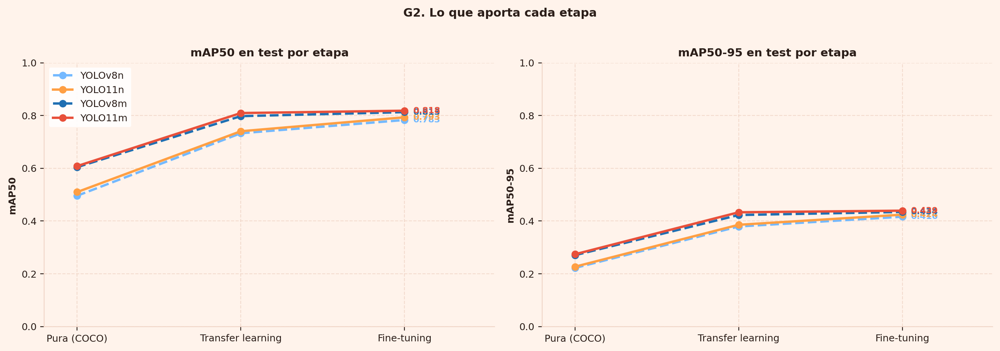

# 🍊 Orange Vision AI — Detección de naranjas con YOLO

Proyecto del curso **Inteligencia Artificial 2026** — Universidad Nacional de Asunción.
Autores: Nicolas De Egea y Sanie Peralta.

Entrenamos y comparamos detectores de objetos (YOLOv8n, YOLO11n, YOLOv8m, YOLO11m y RT-DETR) para encontrar
naranjas en fotos de campo, medimos cuánto aporta cada etapa del entrenamiento (modelo puro → *transfer learning*
→ *fine-tuning*) y usamos el mejor modelo en una demo con cámara en vivo.

## Estructura del repositorio

```
├── README.md          ← este documento
├── data/              ← fuentes de los datasets y división train/val/test usada (las imágenes se descargan)
├── notebooks/         ← notebooks de Colab: datos, entrenamiento, optimización y gráficas (v0 → v4.1)
├── results/           ← tablas CSV y gráficas generadas por los notebooks
│   ├── v2_barrido_lr/       barrido de learning rate (optimización de hiperparámetros)
│   ├── v4_N1500/            4 modelos × 3 etapas en Mendeley (resultado principal)
│   └── v4_1_deepfruits/     mismo experimento en DeepFruits + generalización entre datasets
├── models/            ← pesos entrenados (.pt) y modelos.json con métricas y umbrales
│   ├── v4/                  entrenados en Mendeley (los usa la demo)
│   └── v4_1/                entrenados en DeepFruits
├── serve.py           ← demo local: cámara + detección en vivo (Flask)
├── index.html, _layouts/, assets/, _config.yml   ← página web del proyecto (GitHub Pages)
└── requirements.txt
```

En Google Drive los notebooks escriben en `Proyecto/resultados/` y `Proyecto/modelos/`; en este repositorio esas
carpetas son `results/` y `models/`.

## Notebooks

Todos se ejecutan en **Google Colab con GPU T4** (Ultralytics 8.4.175). El texto y el código están en español.

| Notebook | Qué hace | Salidas |
|---|---|---|
| `OrangeAI_v0.ipynb` | Primeras pruebas con Ultralytics y métricas. | — |
| `OrangeAI_v1.ipynb` | Primer flujo completo con YOLO11: inferencia pura (clase *orange* de COCO), *transfer learning*, *fine-tuning* y webcam. Algunas gráficas de v1 son ilustrativas, no medidas; las cifras del informe salen de v2 en adelante. | — |
| `OrangeAI_v2.ipynb` | Compara YOLO11n, YOLO11m y RT-DETR con 1000 fotos de Mendeley e incluye el **barrido de learning rate** (`lr0` ∈ {1e-3, 3e-4, 1e-4}, decidido solo con validación). | `results/v2_barrido_lr/` |
| `OrangeAI_v3.ipynb` | Versión simplificada y explicada de v2 (teoría en celdas markdown, métricas de `model.val`). | — |
| `OrangeAI_v4.0.0.ipynb` | **v4**, perfil rápido (1 semilla): YOLOv8n, YOLO11n, YOLOv8m y YOLO11m en tres etapas, 1500 fotos de Mendeley. | — |
| `OrangeAI_v4.0.1.ipynb` | **v4**, perfil completo (3 semillas). **Resultado principal.** | `results/v4_N1500/`, `models/v4/` |
| `OrangeAI_v4.1.0.ipynb` | v4 con el dataset pequeño *deepFruits orange* (66 fotos) y generalización entre datasets, 3 semillas. | `results/v4_1_deepfruits/`, `models/v4_1/` |

## Método

1. **Datos** (ver [`data/README.md`](data/README.md)): 1502 fotos de Mendeley *Oranges in the field*, divididas
   train 1050 / val 152 / test 300, sin repetir árbol entre splits. Imágenes de 640 px, una clase (`orange`).
2. **Tres etapas por modelo**, todas evaluadas en el mismo test:
   - **Pura (COCO):** el modelo preentrenado tal cual, usando su clase *orange*.
   - **Transfer learning (Fase 1):** *backbone* congelado, se entrenan *neck* y *head* (10 épocas).
   - **Fine-tuning (Fase 2):** se descongela toda la red con un `lr0` 10 veces menor (hasta 40 épocas, *patience* 10).
3. **Hiperparámetros:** AdamW, batch 16, `lr0` = 1e-3 para los modelos *n* y 3e-4 para los *m* (elegidos con el
   barrido de v2), aumento de datos HSV, traslación, escala, *flip* y mosaico. Configuración completa en
   `results/*/configuracion.json`.
4. **Métricas:** precisión, recall, F1, mAP50 y mAP50-95 en test (media ± desvío de 3 semillas), latencia en GPU y CPU.

## Resultados

### Optimización del learning rate (v2, mAP50-95 en validación, 15 épocas de Fase 1)

| Modelo | lr0 = 1e-3 | lr0 = 3e-4 | lr0 = 1e-4 |
|---|---|---|---|
| YOLO11n | **0.412** | 0.398 | 0.378 |
| YOLO11m | 0.443 | **0.448** | 0.444 |
| RT-DETR | **0.226** | 0.185 | 0.147 |

RT-DETR quedó muy por debajo de YOLO con estos datos y presupuesto, por eso v4 compara solo modelos YOLO.
Tabla: [`results/v2_barrido_lr/barrido_lr.csv`](results/v2_barrido_lr/barrido_lr.csv).

### Mendeley, test de 300 fotos (v4, 3 semillas)

mAP50-95 por etapa:

| Modelo | Pura (COCO) | Transfer learning | Fine-tuning |
|---|---|---|---|
| YOLOv8n | 0.222 | 0.379 | 0.416 |
| YOLO11n | 0.227 | 0.386 | 0.424 |
| YOLOv8m | 0.270 | 0.423 | 0.434 |
| YOLO11m | 0.274 | 0.433 | **0.439** |

Modelos finales (*fine-tuning*):

| Modelo | Precisión | Recall | mAP50 | mAP50-95 | Parámetros | GPU T4 (ms/img) | CPU Colab (ms/img) |
|---|---|---|---|---|---|---|---|
| YOLOv8n | 0.836 | 0.691 | 0.783 | 0.416 | 3.1 M | 7.6 | 110 |
| YOLO11n | 0.835 | 0.699 | 0.793 | 0.424 | 2.6 M | 9.7 | 107 |
| YOLOv8m | 0.850 | 0.731 | 0.813 | 0.434 | 25.9 M | 27.6 | 758 |
| YOLO11m | 0.844 | 0.737 | 0.818 | 0.439 | 20.1 M | 27.9 | 737 |



**Conclusiones principales**

- El *transfer learning* aporta casi toda la mejora (+0.15 a +0.16 de mAP50-95 sobre el modelo puro); el
  *fine-tuning* suma poco más (+0.04 en los modelos *n*, +0.01 en los *m*).
- YOLO11 supera a YOLOv8 del mismo tamaño por muy poco (+0.005 a +0.008) con menos parámetros.
- Los modelos *m* ganan ≈ 0.015–0.018 de mAP50-95 pero son ≈ 3 veces más lentos en GPU y ≈ 7 en CPU.

### DeepFruits, 66 fotos (v4.1)

Con solo 52 fotos de entrenamiento, el mismo proceso lleva YOLO11m de 0.536 (puro) a 0.658 de mAP50-95.
El test tiene 7 fotos, así que diferencias de 0.02–0.03 entre modelos pueden ser azar.

**Generalización entre datasets** (YOLO11m, mAP50-95): el modelo entrenado en Mendeley funciona mejor en DeepFruits
que el modelo puro (0.603 vs 0.536), pero el entrenado en DeepFruits funciona *peor* que el puro en Mendeley
(0.198 vs 0.274): 52 fotos no alcanzan para generalizar. Tabla:
[`results/v4_1_deepfruits/generalizacion_entre_datasets.csv`](results/v4_1_deepfruits/generalizacion_entre_datasets.csv).

## Modelos

| Archivo | Entrenado en | Umbral de máx. F1 (val) | mAP50-95 test |
|---|---|---|---|
| `models/v4/orange_yolo11n.pt` | Mendeley | 0.35 | 0.424 |
| `models/v4/orange_yolo11m.pt` | Mendeley | 0.28 | 0.440 |
| `models/v4/orange_yolov8n.pt` | Mendeley | 0.32 | 0.416 |
| `models/v4/orange_yolov8m.pt` | Mendeley | 0.36 | 0.437 |
| `models/v4_1/*.pt` | DeepFruits | ver `models/v4_1/modelos.json` | — |

Uso desde Python:

```python
from ultralytics import YOLO
modelo = YOLO("models/v4/orange_yolo11n.pt")
resultado = modelo("foto.jpg", conf=0.5)[0]
print(len(resultado.boxes), "naranjas")
```

## Demo con cámara en vivo

```bash
pip install -r requirements.txt
python serve.py
```

Abre `http://localhost:8000`: la página muestra la cámara con las detecciones y permite cambiar de modelo,
mover el umbral de confianza y ocultar cajas o etiquetas. Variables opcionales: `CAMARA=1` (otra cámara) y
`UMBRAL=0.4`.

Valores por defecto y por qué:

- **YOLO11n.** En una CPU de laptop tarda ≈ 35 ms por cuadro frente a ≈ 170 ms de YOLO11m, así las cajas siguen a
  la naranja en lugar de quedar atrasadas. YOLO11m se puede elegir en la página cuando se prioriza la precisión.
- **Umbral 0.50.** El umbral de máximo F1 (≈ 0.3) está calibrado para fotos de campo; frente a la cámara deja pasar
  dedos y piel como "naranjas". Con 0.50 casi todos los frutos reales siguen detectándose.

La página publicada en GitHub Pages muestra el diseño y las métricas; la cámara solo funciona al ejecutar `serve.py`
localmente.

**Historia:** la primera demo usaba un YOLO11n entrenado con 84 fotos de Mendeley (mAP50-95 en validación ≈ 0.30).
Detectaba menos falsos positivos solo porque usaba umbral 0.50, pero también encontraba muchas menos naranjas que
los modelos de v4.

## Limitaciones y trabajo futuro

- Los modelos nunca vieron manos: incluso con umbral 0.50, un dedo puede detectarse como naranja. Agregar fotos de
  manos y piel sin etiquetas (*negativos*) al entrenamiento debería corregirlo.
- Solo se detecta la naranja (caja + confianza); no se estima madurez, tamaño ni posición 3D.

## Referencias

- Lucas et al. *Oranges in the field*. Mendeley Data. https://doi.org/10.17632/93f32zgkxz.1
- Sa, I. et al. (2016). *DeepFruits: A Fruit Detection System Using Deep Neural Networks*. Sensors, 16(8), 1222.
- Sa, I., Lim, J. Y., Ahn, H. S. y MacDonald, B. (2022). *deepNIR: Datasets for Generating Synthetic NIR Images and
  Improved Fruit Detection System Using Deep Learning Techniques*. Sensors, 22(13), 4721.
- Ultralytics YOLO: https://docs.ultralytics.com
- Artículos de contexto (notas en [`ReferenciasBibliograficas/`](ReferenciasBibliograficas/)): *Detection and
  localization of citrus fruit based on improved YOLO*; *A Proposal for Automatic Fruit Harvesting by Combining a
  Low Cost Stereo Vision and Robotic Arm*; *Toward Vision Based Dual Arm Robot Picking Fruit*; revisión
  *Recognition and Localization*.
